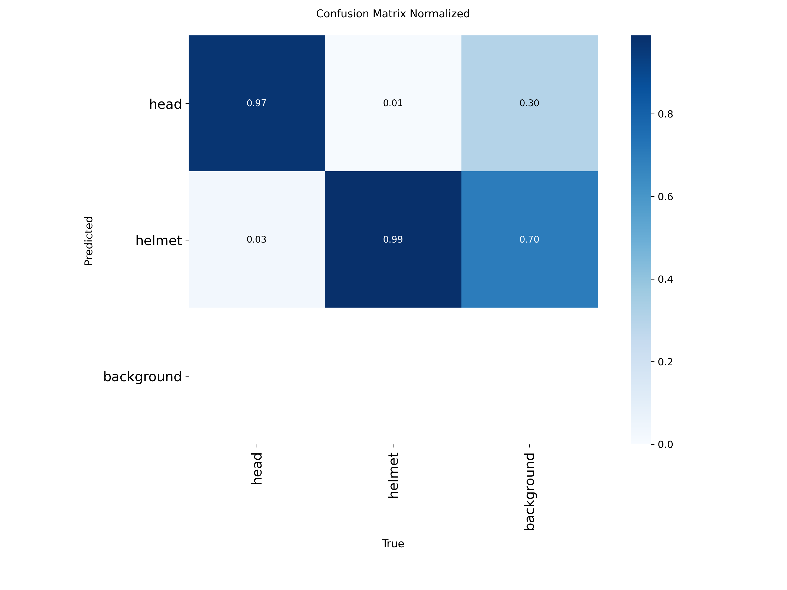
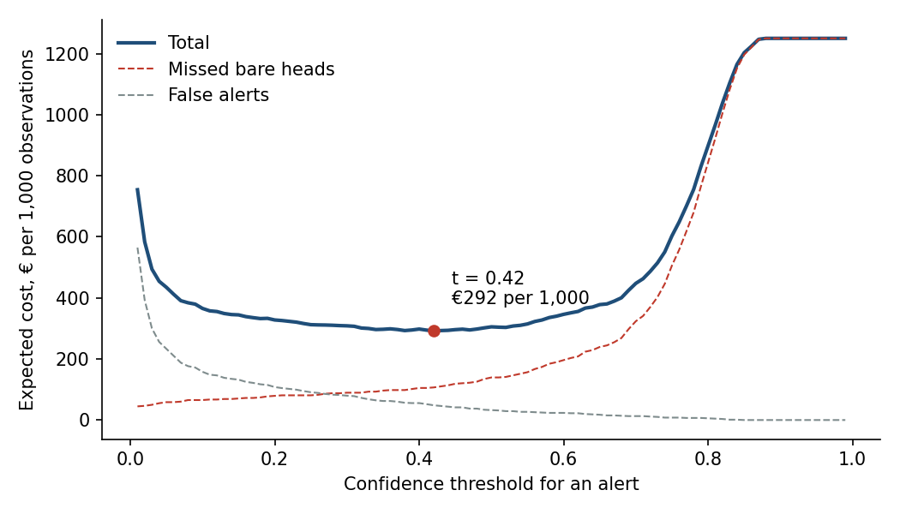

# Assignment 2 Report

> **DRAFT written with Claude.** The course AI policy says the ideas, findings and
> conclusions in this report must be your own. Read every section, change what
> you disagree with, and rewrite the reasoning in your own words before you
> submit. Every number comes from `artifacts/report_tables.md`, generated by
> `main.py train`. Delete this box before submitting.

- **Name**: Constantin Hatecke
- **Student ID**: ⟦your ID⟧
- **Email**: hatecke.coco@gmail.com
- **Group**: ⟦BBADBA 5A / BBADBA 5B / PPLEDBA 5A / BDBA 3A⟧

## Business problem, and the cost of being wrong

**The decision.** On a construction site, the safety supervisor decides whether
to walk over to a worker and stop work because they are not wearing a hard hat.
Today that decision is made by looking: walking the site and glancing at CCTV.
The model watches zone cameras instead. Every 5 minutes each camera sends a
frame, the model scores every head it sees, and each worker observation ends in
one of three outcomes: an alert sends the supervisor over, a borderline case
goes to a person who checks the frame first, or nothing happens.

**Unit and positive class.** One case is one worker observation: one head in
one frame. The positive class is `head`, meaning a worker without a hard hat.
`helmet` is the negative class.

**What each mistake costs.**

| Outcome | Cost | Why |
| --- | --- | --- |
| False negative: bare head, no action | €25 | The worker stays unprotected at least until the next frame. Expected cost = chance of a head injury in that window × its cost, plus the chance an inspector sees it × the fine. I assume a 1 in 20,000 chance of a serious head injury per uncorrected observation and €500k for a serious accident once lost time, sanctions, the employer's benefit surcharge and the site stopping are counted, which gives €25. Fines for a serious prevention breach start at €2,451 ([LISOS art. 40, Gómez-Acebo & Pombo](https://ga-p.com/publicaciones/nuevas-cuantias-de-las-sanciones-laborales/)). |
| False positive: alert on a compliant worker or on nothing | €3 | Supervisor walks over for nothing: about 5 minutes at €30/h fully loaded (€2.50) plus about a minute of the worker's time. |
| True positive: alert on a real bare head | €3 | The same walk happens. It is cheaper than the miss it prevents, not free. |
| Human review of one frame | €0.10 | About 12 seconds at €30/h. |
| True negative | €0 | Nothing happens. |

A miss costs about 8 times a false alert. That ratio, not the absolute euros,
is what moves the threshold, so it is the figure to defend. The weakest number
is the injury probability: it is an assumption, not a measured rate. The
sensitivity section shows what happens if it is 4 times higher or lower.

A second cost does not fit in a per-case euro figure: **alert fatigue**. If
most alerts are wrong, supervisors stop walking over, and the system's real
recall falls to zero. That is a reason to care about precision at the
operating point and not only total cost.

**Production assumptions.** A mid-size site with 4 cameras, a frame every 5
minutes over a 10-hour day, and about 6 workers visible per frame gives 2,880
observations a day. I assume 5% of observations are workers without a hard hat
on a site that already enforces the rule. Reviewers spend 6 productive hours a
day on review and still miss 5% of real bare heads.

Construction is where this matters most in Spain: 164 workers died in workplace
accidents in construction in 2025, up 21.5% on 2024
([Forbes España](https://forbes.es/economia/873723/mueren-735-trabajadores-en-accidente-laboral-en-2025-61-menos-que-el-ano-anterior/)).

## Dataset

- Workspace: `joseph-nelson`
- Project: `hard-hat-workers`
- Version: **13**
- Link: https://universe.roboflow.com/joseph-nelson/hard-hat-workers/dataset/13
- Licence: Public Domain. Used as published, not forked.

One image is a photo of people at a work site. Every visible head is boxed and
labelled `head` (no hard hat) or `helmet` (hard hat on). Version 14 was skipped
by the pipeline because it merges `helmet` into `head`, which removes the
distinction the decision depends on.

Why it serves the decision rather than only resembling it: the decision is
made per head, and the labels are per head, with exactly the two states the
supervisor acts on. A dataset of construction scenes with only `person` boxes
would look similar and be useless here.

## What the dataset's composition implies

| Split | Images | `head` | `helmet` | Images with a bare head |
| --- | --- | --- | --- | --- |
| Train | 14,748 | 13,670 | 41,450 | 2,729 |
| Valid | 1,413 | 1,339 | 3,913 | 256 |
| Test | 706 | 726 | 1,915 | 140 |

| Class | Median box width | Median box area | Boxes under 1% of image area |
| --- | --- | --- | --- |
| `head` | 7.0% of image width | 0.78% | 61% |
| `helmet` | 8.4% | 1.08% | 48% |

What this implies:

- **The per-class numbers are trustworthy in size.** 726 bare heads and 1,915
  helmets in test is enough for stable precision and recall. The caveat is
  clustering: the 726 bare heads sit in only 140 images, about 5 per image, so
  they are not independent. A few crowd photos carry a lot of the `head` score.
- **The test base rate is far from production.** 27.5% of test workers have no
  hard hat, against my assumed 5% on site. At 5%, a false alert on a worker
  weighs about 7 times more relative to a true alert than it does in the test
  set (weights 0.95/0.725 against 0.05/0.275), so
  raw test precision overstates how good alerts will look on site. The cost
  model reweights positives and negatives to 5% for this reason.
- **The training split is about 3 times larger than it should be.** An 87/8/4
  split with 706 test images points to Roboflow's 3× augmentation of the
  training set. That inflates the training count, not the information in it,
  and it does not touch valid or test, so the evaluation is still clean.
- **Heads are small.** 61% of bare heads cover less than 1% of the image. Misses
  will concentrate on workers far from the camera, which is exactly what a site
  camera mounted at height produces.
- **Test does not look like production.** These are mostly close, eye-level web
  and news photos, many from Chinese sites. Site CCTV looks down from height, at
  lower resolution, in dust and rain. The test score is an upper bound on what
  the site would see.

## Finetuning and baselines

`yolo11n`, finetuned from the COCO checkpoint for object detection. Trained on
Kaggle (Tesla T4): 20 epochs at 416 px (the dataset's native resolution), batch
32, seed 0, 20.9 minutes. Early stopping (patience 5) never triggered.

| Model (same 706 test images) | AP50 | mAP50-95 | `head` AP50 | `head` recall | `head` precision |
| --- | --- | --- | --- | --- | --- |
| Finetuned yolo11n | **0.959** | **0.640** | **0.948** | 0.935 | 0.897 |
| COCO yolo11n zero-shot | 0.000 | 0.000 | 0.000 | 0.000 | 0.000 |
| Predict nothing | 0.000 | 0.000 | 0.000 | 0.000 | 0.000 |

Precision and recall at confidence 0.25, IoU 0.5. The Ultralytics validator on
the same split gives AP50 0.961 and mAP50-95 0.658, so the evaluator used for
all three models agrees with it.

The gap is as large as it is by construction. COCO has no `head` or `helmet`
class, so the zero-shot model cannot express the decision at all, and in cost
terms it is identical to doing nothing. Predict-nothing is also the
majority-class answer, since 72.5% of test workers wear a hard hat. Neither
baseline is a serious competitor. The real benchmark for the model is the
"person checks every frame" policy in the review section.

Validation mAP50-95 was still rising at epoch 20 (0.645, 0.646, 0.647, 0.648
over the last four epochs), so more epochs would add a little, mainly in box
precision rather than in finding heads.

## Per-class evaluation and failure modes

| Class | Test instances | Precision | Recall | AP50 | AP50-95 |
| --- | --- | --- | --- | --- | --- |
| `head` (positive) | 726 | 0.897 | 0.935 | 0.948 | 0.648 |
| `helmet` | 1,915 | 0.913 | 0.943 | 0.970 | 0.632 |

Confusion matrix at confidence 0.25, IoU 0.5 (rows predicted, columns true):

| | True `head` | True `helmet` | True background |
| --- | --- | --- | --- |
| Predicted `head` | 677 | 6 | 71 |
| Predicted `helmet` | 13 | 1,804 | 156 |
| Missed (background) | 36 | 105 | 0 |

- **`helmet` carries the headline AP** (0.970), because it is the largest and
  visually easiest class: a bright hard hat is a strong signal. `head` is the
  harder class and the one the decision depends on, at 0.948.
- **The model rarely confuses the two states.** Only 13 bare heads were called
  `helmet` and 6 helmets called `head`. The costly errors are not mix-ups but
  misses (36 bare heads not found at all) and alerts on things that are not
  labelled as workers (71).
- **Misses are small or occluded heads.** The failure examples show a driver
  behind cab glass, a face half-hidden behind another worker's hard hat, and a
  distant head in a crowd (`artifacts/failures/00` to `03`).
- **Many "false alerts" are labelling gaps.** The highest-scoring alerts on
  background (`artifacts/failures/07`, `08`) are clearly bare heads that the
  annotators did not box. The model is right and the label is missing. The
  measured precision for `head` is therefore a lower bound.
- **Helmet false alerts are partly occluded or distant workers**, where the hard
  hat is cut off or a few pixels wide (`artifacts/failures/04` to `06`).

## Cost matrix and operating point

For every threshold from 0.01 to 0.99, the pipeline counts TP, FP, FN and TN
over the 2,641 test workers plus the alerts on background, reweights positives
and negatives from the 27.5% test base rate to the 5% production rate, applies
the cost matrix and scales to 1,000 observations.

**Operating point for the model alone: threshold 0.42, €292 per 1,000
observations.** At 0.42 the model finds 91.5% of bare heads with 94.2% of its
alerts correct on the test set.

| Threshold | € per 1,000 | Recall | Precision | FN | FP |
| --- | --- | --- | --- | --- | --- |
| 0.20 | 328 | 0.937 | 0.881 | 46 | 92 |
| 0.30 | 308 | 0.928 | 0.908 | 52 | 68 |
| **0.42** | **292** | **0.915** | **0.942** | **62** | **41** |
| 0.50 | 305 | 0.888 | 0.958 | 81 | 28 |
| 0.70 | 448 | 0.741 | 0.980 | 188 | 11 |

The curve is flat between about 0.3 and 0.5 (within €16 per 1,000) and climbs
steeply above 0.6, where misses take over. Setting the threshold a bit too low
is cheap, setting it too high is expensive, which is the cost asymmetry showing
up in the curve.

Part of the cost cannot be avoided by any threshold: at a 5% base rate there
are 50 real bare heads per 1,000 observations, and correcting each one costs
€3, so €150 of every 1,000 is the price of doing the job at all. The avoidable
part is €142 at the chosen threshold.

**Sensitivity.** The best threshold moves with the FN:FP ratio, as it should:

| Change | Best threshold | € per 1,000 |
| --- | --- | --- |
| c_FN × 0.25 (€6.25) | 0.54 | 197 |
| c_FN × 0.5 (€12.50) | 0.52 | 233 |
| **as assumed (€25)** | **0.42** | **292** |
| c_FN × 2 (€50) | 0.34 | 389 |
| c_FN × 4 (€100) | 0.14 | 552 |
| Base rate 2.5% | 0.52 | 166 |
| Base rate 10% | 0.34 | 528 |

The assumption that would most change the answer is the injury probability
behind c_FN. If a miss costs no more than a false alert (c_FN at or below €3,
the same as the walk itself), never alerting is as good as anything the model
can do. At twice a false alert (€6) the model already costs a third less than
doing nothing, and across a 16-fold range of c_FN the threshold stays between
0.14 and 0.54.

## What a person still has to check

**Review band: alert above 0.66, review between 0.03 and 0.66, no action below
0.03.** The grid search over all threshold pairs put the lower edge very low
because a review (€0.10) is so much cheaper than a miss (€25): it is worth
having a person glance at almost any head the model is unsure about.

- Share of cases sent to review: **10.3%**
- Reviews per day: 10.3% × 2,880 ≈ **296**
- Time: 296 × 12 s ≈ **59 minutes a day**, which is **0.16 of one reviewer**
- Bare heads caught (model plus reviewer): **95.2%**

That is realistic. Nobody needs to be hired: an hour a day fits into the
existing supervisor's or site office's day, in short batches.

| Policy | € per 1,000 | € per day | Share reviewed | People |
| --- | --- | --- | --- | --- |
| Do nothing | 1,250 | 3,600 | 0% | 0 |
| Person checks every frame | 305 | 878 | 100% | 1.6 |
| Model alone (t = 0.42) | 292 | 842 | 0% | 0 |
| **Model + review (0.03 / 0.66)** | **228** | **656** | **10.3%** | **0.16** |

- Every option with a camera beats doing nothing by at least €2,700 a day.
- **The model alone barely beats a person checking every frame** (€292 vs €305).
  On paper a person is competitive because reviews are cheap. In practice the
  check-everything option is weaker than it looks: 2,880 checks a day is 9.6
  hours of staring at frames, and a 5% miss rate for that is optimistic.
- **Model plus review is the cheapest** at €228, €186 a day less than the model
  alone and €222 less than checking everything, while using a tenth of a
  person's day. The avoidable cost falls from €142 to €78 per 1,000.
- **It also answers alert fatigue.** At the site's 5% base rate, only 74% of the
  model-alone alerts are real bare heads, so one walk in four is for nothing.
  With the review band, 89% of alerts are real, because the doubtful cases are
  filtered by a 12-second check before anyone walks.

Recommendation: ship the model with the review band, not alone.

## Limitations & next steps

- **Domain gap.** Web and news photos are not CCTV. Label a few hundred frames
  from one real site camera and re-measure recall before trusting 0.42 or the
  band.
- **Missing labels.** The top "false alerts" on background are unlabelled bare
  heads. Re-labelling the 50 highest-scoring background alerts would give a
  truer precision and would likely move the threshold down.
- **Injury probability is assumed.** Replace it with the site's own incident and
  near-miss data (one number in `costing.py`), then re-run with
  `SKIP_TRAIN=1 uv run python main.py train`.
- **Observations are not independent.** The same worker appears in many frames,
  so a miss now may be caught 5 minutes later. Costing per worker-hour instead
  of per frame would lower the effective c_FN.
- **Alert fatigue is not in the euros.** A floor on alert precision (for example
  90% at the production base rate) would make it an explicit constraint.
- **"Do nothing" is generous to the model.** Today supervisors already walk the
  site and catch some bare heads by eye. With no data on how many, the real
  saving is smaller than the €2,750 a day against no camera at all.
- **System costs are left out.** Cameras, inference hardware and maintenance are
  not in the per-case costs. At savings of this size they pay back quickly, but
  a full business case would net them off.
- **Training was cut at 20 epochs** while validation was still improving
  slightly. A longer run, or `yolo11s`, would mainly help small, distant heads.
- **Clustered positives.** 726 test bare heads come from 140 images, so
  confidence intervals should be computed by resampling images, not boxes.

## Generative AI use disclosure

I used Claude (Anthropic) for this assignment. It searched Roboflow Universe
for candidate datasets, wrote the code (`train.py`, `evaluation.py`,
`costing.py`, `app.py`), tested it on a synthetic dataset, and drafted this
report including the first version of the cost figures and their reasoning.
I chose the problem and the dataset, reviewed and ⟦changed / kept⟧ the cost
assumptions, ran the training on Kaggle, and rewrote the analysis in my own
words. ⟦Edit this to match what you actually did.⟧
